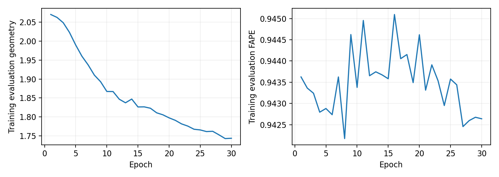

# SE(3) refiner investigation, 2026-10-09

Status: investigation complete; larger training remains deferred. All experiments used CPU while both GPUs were occupied.
Production checkpoints and the mk2 HDF5 dataset were unchanged. Frozen caches supplied the inputs; no production model forward calls or graph regeneration were needed.
The original validation protocol and its historical metrics remain separate from this investigation.

## Coordinate units and seed preservation

A single scale factor **10.928414** was fitted from only the original 32 training structures using equal-structure pair-distance least squares. None of the 128 evaluation structures contributed to calibration or model selection.

| Seed on 32 training structures | FAPE | CA RMSD Å | TM-score | CA lDDT | Bond MAE Å |
|---|---:|---:|---:|---:|---:|
| raw | 0.944481 | 18.456422 | 0.083547 | 0.019812 | 3.636395 |
| calibrated | 0.944025 | 16.429471 | 0.189482 | 0.161431 | 2.381320 |

Calibration improves geometry without optimizing the refiner. Those gains must not count toward the learning gate. A zero-initialized residual preserves this calibrated seed; absolute projected coordinates discard its scale.

## Controlled screens

All screens used the same eight shortest training structures for 10 epochs (10 optimizer updates), width 32, depth 2, two heads, head dimension 16, AdamW 5e-4, effective batch 8 and clipping 1. These are diagnostic screens, not independent validation.

| Case | Initial geometry | Best geometry | Reduction | Initial angle loss | Final angle loss |
|---|---:|---:|---:|---:|---:|
| raw_absolute | 2.667956 | 2.660397 | 0.283% | 1.123596 | 1.096983 |
| raw_residual | 2.519096 | 2.518932 | 0.007% | 1.123596 | 1.098372 |
| calibrated_absolute | 2.667790 | 2.660616 | 0.269% | 1.124898 | 1.097129 |
| calibrated_residual | 1.768719 | 1.768711 | 0.000% | 1.124898 | 1.098250 |
| calibrated_residual_rms | 1.768721 | 1.768644 | 0.004% | 1.121631 | 1.098576 |
| rms_geometry_scheduler | 1.768721 | 1.768644 | 0.004% | 1.121631 | 1.098576 |
| rms_gain32 | 1.768721 | 1.703828 | 3.669% | 1.121631 | 1.095945 |
| rms_gain32_circular | 1.768721 | 1.708097 | 3.428% | 1.122434 | 1.059805 |

The first five cases used a FAPE-driven scheduler. The last three used a geometry-driven scheduler. RMS normalization alone barely helped. Multiplying the normalized vector update by 32 produced a measurable learning signal. Gain 32 compensates for the small initial per-channel degree-1 norms; it is an experimental parameterization, not an established universal constant.

Measured degree-1 component RMS was 0.01804 (approximately 1/(32√3)). Geometry projection gradients were nonzero, 0.040–0.143 on four representative structures. The original short-screen scheduler reduced learning rate from 5e-4 to 5e-6 because clamped FAPE barely moved.

## Bounded 32-structure learning test

The selected `overfit_rms_gain32` case was reinitialized and trained for 30 epochs / 120 updates on all 32 original structures. Selection used training geometry only. The circular head was not selected by this small screen; this is not evidence that the bounded head is adequate.

Geometry: **2.074647 → 1.742918**, a **15.99%** reduction from the calibrated, identity-initialized model. Selected epoch: 29.

Training FAPE: 0.944026 → 0.942676. The ≥20% geometry learning requirement is **False**.

## Paired evaluation on 128 disjoint structures

This evaluates a refiner trained on 32 structures; it is not a repeat of the 512-structure pilot. These structures are refiner holdouts, with no claim of independence from production pretraining. No uncertainty intervals were computed.

| Metric | Raw seed | Calibrated seed | Refined | Refined − calibrated |
|---|---:|---:|---:|---:|
| fape | 0.949674 | 0.948203 | 0.952135 | +0.003932 |
| ca_rmsd | 20.933254 | 18.331848 | 19.057096 | +0.725248 |
| tm_score | 0.077176 | 0.185848 | 0.196851 | +0.011003 |
| lddt | 0.020676 | 0.162993 | 0.186988 | +0.023994 |
| ca_bond_mae | 3.644222 | 2.469156 | 2.453198 | -0.015958 |
| ca_bend_mae_radians | 1.443426 | 1.443426 | 1.026789 | -0.416637 |
| ca_torsion_mae_radians | 1.555018 | 1.554986 | 1.576647 | +0.021661 |

Held-out FAPE improves over the calibrated input: **False**. The learned residual regresses on this metric despite some distance-based improvements.

## Fundamental planarity constraint

Every training seed is essentially planar: maximum smallest/largest singular-value ratio **1.75e-07**. The production decoder has `residual=False` and a final three-channel LayerNorm. Its affine output satisfies Σᵢ(xᵢ−βᵢ)/γᵢ=0, a plane constraint. These are latent contact features, not a physical three-dimensional coordinate head.

GotenNet builds degree-1 vectors from relative coordinates and scalar-weighted vector combinations. Such updates preserve an exactly planar input. Trained output checks remained within **0.000683 Å** of the input plane. Small departures reflect numerical noise. Even an optimal planar approximation of these targets has a mean aligned RMSD lower bound of **5.848 Å**.

A prototype uses an invariant latent scalar and the oriented cross-product normal of neighboring seed bonds to lift the coordinates. It uses no target coordinates, random noise or fixed global axis. It is SO(3)-equivariant, deliberately not reflection-equivariant, and masks undefined or incomplete normal stencils.

At fixed lift fraction 0.1, all 32 prototype seeds became full rank (minimum singular-value ratio **0.084**). Prototype seed FAPE/TM-score/bond MAE were **0.943514 / 0.194362 / 1.700 Å**. These are untrained seed measurements; the lift has not passed a refiner training gate.

## Angle range and metric corrections

The legacy tanh angle head is limited to ±1 radian. **77.1%** of valid training targets are outside that interval; the theoretical mean circular loss floor is **0.634401**. An opt-in sin/cos head covers the full circle and rejects undefined zero pairs. Its initialization, gradients, representable range and invariance were tested.

Float32 matrix-product distances can suffer translation cancellation and nonzero self-distances. Pair-distance losses and metrics now center coordinates; lDDT explicitly excludes the diagonal. Historical v2 lDDT figures are retained as originally measured, and should not be compared directly with the corrected figures above.

## Remaining gate and reproducibility

A larger run is still premature. A future bounded test must train from a full-dimensional seed or add a tested SO(3) normal-direction update, use a physically valid angle head, and demonstrate the 20% overfit learning gate plus paired held-out quality. Increasing duration or width cannot remove an exactly planar geometric constraint.

All new model modes are opt-in; default absolute coordinates and the bounded angle head remain available for historical comparison. The staged transformer and production model files were not changed. The first metric-control attempt was preserved, and the preliminary 32-structure gain-1 run was stopped after six epochs once its gradient/scale limitations were measured.

The evidence directories preserve source snapshots, configurations, IDs, calibration, screens, paired metrics, gradient diagnostics, planarity checks, learning curves, logs and checkpoint inventory. CPU correctness checks passed; CUDA-specific checks were deferred while the GPUs were occupied.

CPU resource measurements: two configured Torch threads, peak observed resident memory **3.36 GiB**, full-training epoch time **39.7 seconds** on average. No GPU memory was allocated by the investigation entrypoint.

See the [evidence index](se3_investigation_evidence/README.md) for retained files and source identities.
