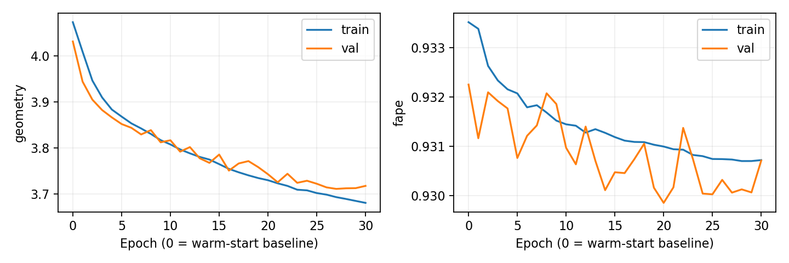

# Larger workstation SE(3) trial

Started 2026-10-13, following the successful [512/128 pilot](se3_revised_pilot.md).
This run uses 4,096 new training structures and 512 new validation structures,
all complete chains at most 256 residues. All 640 structures used in the previous
smoke, overfit and pilot experiments are excluded from both splits. The split
is structure-level, without a claim of independence from production pretraining.

The refiner warm-starts from the selected pilot checkpoint (epoch nine).
Its architecture, lifted seed, calibration and soft-FAPE/local-bond objective
are unchanged. Optimizer and scheduler are reset for this new cohort. The full
warm-start training and validation losses are measured before any update;
subsequent learning must be measured from those values, not from the earlier
untrained seed or the first online training epoch.

The smaller length cap keeps dense adjacency costs bounded and makes many more
optimizer steps practical. Each complete epoch has 512 updates, versus 64 in
the pilot. The maximum budget is 30 epochs / 15,360 updates, with an eight-hour
training limit checked between epochs, including recorded training time across
resume attempts. Cache preparation and initial evaluation are separate from
that training limit. Actual learning is not guaranteed.

The checkpoint and early-stopping metric is validation objective geometry,
which directly reflects the optimized soft-FAPE, distance and bond terms.
Patience is eight and minimum improvement is 0.001. ReduceLROnPlateau reduces
learning rate by 0.5 after three plateau epochs. Clamped FAPE remains an
unchanged evaluation metric and is logged separately. Batch size remains one,
effective batch eight, float32, AdamW 5e-4 / weight decay 0.01, and clip one.

Configuration: [se3_larger_local.yaml](../configs/se3_larger_local.yaml).
The existing mk2 HDF5 is read directly. Cache extraction verifies the manifest
epoch-40 pair, dataset hash, extractor and cache identity, fresh/cached parity,
and unchanged frozen weights. It does not regenerate graphs. The namespace
retains its existing extraction identity (maximum eligible length 384); the
new selection limit of 256 is recorded separately in cohort provenance.

```bash
source /home/dmoi/miniforge3/etc/profile.d/conda.sh
conda activate foldtree2
export PYTHONPATH=/tmp/foldtree2-se3-deps:$PWD
export CUDA_VISIBLE_DEVICES=0 OMP_NUM_THREADS=2 MKL_NUM_THREADS=2
python -m scripts.prepare_se3_larger_cohort --config configs/se3_larger_local.yaml
python -m scripts.train_se3_revised_pilot --config configs/se3_larger_local.yaml
# Interrupted training resumes under identical input/source/config provenance:
python -m scripts.train_se3_revised_pilot --config configs/se3_larger_local.yaml --resume-from runs/se3_larger_local_20261013/last.pt
```

The persistent user service `foldtree2-se3-larger-local-20261013.service`
runs the two stages sequentially on GPU 0. GPU 1 is excluded. The launcher
`runs/se3_larger_local_20261013/launch.sh` reuses existing valid cached entries
and resumes `last.pt` if present. Missing or incompatible inputs fail explicitly.

```bash
systemctl --user status foldtree2-se3-larger-local-20261013.service
tail -n 10 runs/se3_larger_local_20261013/console.log
```

Outputs retain cohort IDs/exclusions/skips, configuration and source hashes,
cache events, initial losses, per-epoch train/validation objective and FAPE,
finite gradient checks, memory measurements and atomic best/last checkpoints.
Completion evaluates all 512 validation structures against raw and lifted
inputs and the warm-start checkpoint on identical masks. Compare FAPE, RMSD, TM-score, CA lDDT and backbone
geometry; do not attribute warm-start or seed-calibration gains to this run's
learning. No production checkpoint replacement or Clariden job is part of this
experiment.

## Completed results

The trial completed on 2026-10-13: 30 epochs, 15,360 optimizer updates and
5.22 hours of training on GPU 0. Peak allocated GPU memory was 1.59 GiB.
There were no recorded training failure events. Production parameters stayed
frozen during cache extraction; training used only cached outputs.

The selected checkpoint is epoch 27, chosen by validation objective geometry.
Validation geometry decreased **4.031336 → 3.711433 (7.94%)** relative to the
same cohort's measured warm-start loss. Final online training geometry was
3.681065, versus initial fixed-model training geometry 4.073259; online epoch
averages involve changing weights and should not be treated as a fixed-model
paired evaluation.

| Metric | Warm-start checkpoint | Selected larger-trial checkpoint |
|---|---:|---:|
| Clamped FAPE | 0.932249 | 0.930058 |
| Aligned CA RMSD, Å | 16.304992 | 15.775894 |
| TM-score | 0.207644 | 0.214888 |
| CA lDDT | 0.248575 | 0.255721 |
| CA bond MAE, Å | 1.271897 | 1.011462 |
| CA bend MAE, radians | 0.746848 | 0.711077 |
| CA torsion MAE, radians | 1.537429 | 1.518288 |
| Angle-head circular MAE, radians | 0.580129 | 0.541290 |

Comparisons use identical structures and masks, with 512 pairs for every metric
except torsion (511). One structure has undefined torsion under both models;
that pair is excluded only from the torsion aggregate. FAPE improved on 378/512
structures and bond MAE on 504/512. All aggregate metrics improved, passing the
existing FAPE and no-material-regression screens (>5% error increase or >0.01
TM-score/lDDT decrease). No significance or uncertainty claims are made.

The objective demonstrably decreases on this fresh structure-level validation
cohort. Most improvement is in local geometry; global fold-quality improvement
is modest and absolute reconstruction error remains large. These results do
not establish independence from production pretraining or production readiness.



The `docs/se3_larger_local_evidence` archive retains executed sources, hashes,
configuration, initial losses, curves, split/exclusion/skip records, per-structure
raw/lifted/warm-start/refined metrics, resource measurements and checkpoint
inventory. Weights and the frozen cache remain local; production checkpoints
were not replaced.

Launch checks passed: cohort selection excludes prior IDs and undefined
geometry; a real CPU forward/backward test verifies warm initialization,
initial loss and structural baselines, geometry-based monitoring, partial
accumulation groups, and checkpoint resume without duplicate epochs. Existing
loss/frame/resume tests also passed. An atomic `initial.pt` allows recovery
if initial evaluation is interrupted before the first training epoch.
