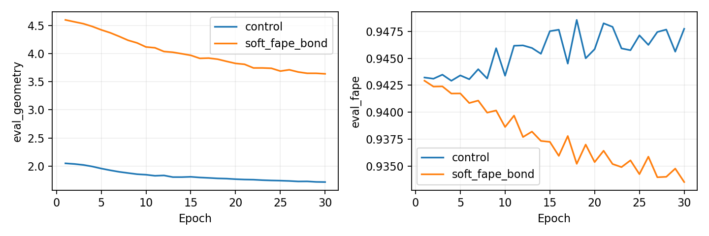

# SE(3) loss ablation, 2026-10-09

Four eight-structure/ten-epoch screens isolate hard versus soft FAPE and the local bond term. Two predeclared cases—original control and combined soft-FAPE/bond objective—were then reinitialized and trained on the same 32 structures for 30 epochs each, with identical seed 42, order, architecture and optimizer. Each was evaluated on the same 128 disjoint structures; holdouts did not select a loss or checkpoint.

The original CA-frame evaluation FAPE still clamps at 10 Å and divides by 10. The revised training term is pseudo-Huber: mean(sqrt(1+(frame_error/10 Å)²)−1), with a nonzero linear-tail gradient rather than a hard clamp. The bond term is SmoothL1 in Å (beta 1 Å, weight 1) against contiguous target CA distances. Adjacent masked residues and target distances outside [2.5,4.5] Å are excluded as gaps. Distance SmoothL1/10 and circular angle weight 0.1 are retained.

These fixed weights were declared before the experiment. An eligibility window based on target bond length is a training-only continuity heuristic, not a claim of chemically validated atom geometry. Coordinate metrics still use the original identical masks; no evaluation mask was changed to improve a result.

| Screen | Initial objective geometry | Best | Reduction | Initial clamped FAPE | Final clamped FAPE |
|---|---:|---:|---:|---:|---:|
| control | 1.750924 | 1.684364 | 3.80% | 0.914139 | 0.911518 |
| bond_only | 3.202517 | 2.980520 | 6.93% | 0.914139 | 0.912433 |
| soft_only | 2.442728 | 2.310503 | 5.41% | 0.914139 | 0.909627 |
| soft_fape_bond | 3.894321 | 3.683142 | 5.42% | 0.914139 | 0.911207 |

| Full 32-structure case | Initial objective geometry | Best | Reduction | Selected epoch |
|---|---:|---:|---:|---:|
| control | 2.052543 | 1.716259 | 16.38% | 30 |
| soft_fape_bond | 4.630304 | 3.641073 | 21.36% | 30 |

Objective magnitudes and percentage reductions belong to each loss definition and must not be compared as the same geometry metric. Both models start from identical lifted coordinates. Checkpoints use their own training objective, never held-out quality.

| Held-out metric | Lifted input | Original loss | Revised loss | Revised − input | Improved / 128 |
|---|---:|---:|---:|---:|---:|
| fape | 0.947859 | 0.958275 | 0.943282 | -0.004577 | 111 |
| ca_rmsd | 18.403283 | 19.561936 | 17.869356 | -0.533927 | 83 |
| tm_score | 0.192221 | 0.193916 | 0.197020 | +0.004799 | 66 |
| lddt | 0.195812 | 0.195024 | 0.211852 | +0.016040 | 89 |
| ca_bond_mae | 1.762846 | 3.896238 | 1.629335 | -0.133510 | 98 |
| ca_bend_mae_radians | 0.843561 | 0.828237 | 0.782218 | -0.061343 | 109 |
| ca_torsion_mae_radians | 1.566216 | 1.547722 | 1.561794 | -0.004422 | 75 |

Gates: ≥20% own-objective training reduction **True**; better held-out FAPE **True**; no material structural regression **True**. Material regression uses the existing >5% error / >0.01 TM-score or lDDT thresholds. Eligible for a revised 512/128 pilot: **True**. Larger training remains deferred pending a successful pilot.

TM-score is TM-align; lDDT and bend/torsion metrics are CA-only. These are refiner holdouts, not a claim of independence from production pretraining. Per-structure comparisons are retained without significance or uncertainty claims.

All cases use the fixed fraction-0.1 oriented-normal lift, circular angles, zero-initialized residual with gain 32 and RMS normalization, width 32/depth 2/two heads/head dimension 16; float32, batch 1/effective 8, AdamW 5e-4/weight decay 0.01, clip 1 and geometry-based scheduler. Only existing frozen epoch-40 caches were read; no production forward calls, checkpoint replacement or graph regeneration occurred.

Failure events: 0. Full-run peak allocated memory: 1.594 GiB. Mean epoch times: control 5.36 s, soft_fape_bond 5.99 s.

Source hashes, executed snapshots, software/device identity, IDs, initial component values/gradient norms, logs and local checkpoint hashes are retained in the evidence archive. The historical objective remains the canonical default; revised training is opt-in.
