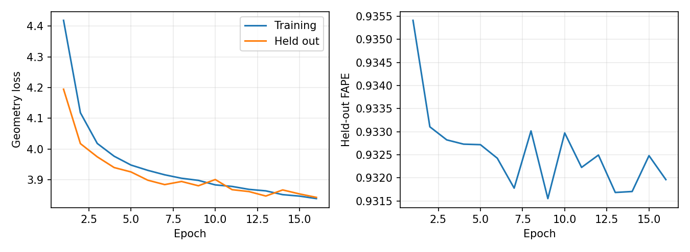

# Longer normalized medium SE(3) trial, 2026-10-14

The user authorized a longer learning trial after the one- and two-node
[gradient precision checks](se3_gradient_precision_20261014.md) passed, including
exact model, optimizer, checkpoint recovery and held-out metric comparisons.
This trial uses the same verified training mathematics with a fresh seed-42
initialization. It does not resume the short debug checkpoints.

Configuration: `configs/clariden_se3/medium_fp64_trial.yaml`. Train on the existing
4,096-structure frozen cache, validate on the same disjoint 512 structures each
epoch, and cap each structure at 256 residues. Run width 64, depth 4, four heads
of dimension 16, parameter-free tensor feed-forward input normalization and
float64 gradient accumulation/reduction. Forward/backward, parameters and AdamW
remain float32. Global batch 16 means one structure per microbatch and two
microsteps per rank across eight ranks. AdamW learning rate is 5e-4, clipping 1,
with no scheduler. Losses, calibration, masks and frozen production pair are
unchanged. This is a fixed 16-epoch trial (4,096 optimizer updates); there is no
automatic extension or subsequent scale-up.

Allocate two GH200 nodes/eight GPUs on `normal` for at most two hours: **16 GPUh
maximum reservation**. The shared rollout ledger remains authoritative; its
prior reservations are 52 GPUh, so this submission brings the conservative
total to 68 of the user-authorized 256 GPUh ceiling. This is reservation
accounting, not a fresh portal credit balance. The user confirmed sufficient
project credit. The trial-only schedule does not authorize all older expansion
stages cumulatively; later stages require reconciliation against the same ledger.

The short two-node check measured approximately 24 global structures/s during
updates. Sixteen full epochs contain 65,536 training structure visits, suggesting
about 45 minutes for updates alone. Validation, startup and checkpointing add
time; the two-hour wall limit is a bound, not a completion guarantee.

Use the pinned ARM extended PyTorch image and already prepared environment
recorded in the precision report. No production checkpoint is replaced, no
graphs regenerated, and no unrelated model or workload changed.

After staging a verified code archive in a fresh revision-named directory:

```bash
python3 -m scripts.submit_se3_long_trial --available-credit 256 --submit
```

Here `256` follows the user's existing credit confirmation and authorized
ceiling; it is not a measured portal balance. The launcher verifies both
stability gates, rejects an existing trial output or duplicate budget reservation,
checks Slurm resource acceptance, then records the actual submission receipt.
It submits once, without automatic requeue or retry.

Durable output is
`/capstor/store/cscs/swissai/a0117/foldtree2/se3/runs/medium_fp64_trial`.
`last.ckpt` is saved every 64 completed optimizer updates and at epoch ends;
`best.ckpt` selects complete-epoch validation geometry. Checkpoints include
optimizer, stream, RNG and provenance. Resume uses the exact pinned source and
configuration with `--resume-from .../last.ckpt` after an explicit bounded
recovery decision. A walltime interruption must not silently extend the budget.

At completion, inspect all epoch means and paired validation files, finite
weights/optimizer state, failure counts, throughput and peak memory. Report
epoch-one versus best training/validation geometry and FAPE, plus baseline versus
refined FAPE, aligned CA RMSD, TM-score, lDDT, backbone bonds and angle errors on
identical structures/masks. Raw-decoder improvements include the pre-existing
coordinate calibration and seed lift; epoch trends establish learning beyond
that preprocessing. These are refiner holdouts, not evidence of independence
from production pretraining. The historical small model used different
normalization and accumulation, so this trial is not a matched capacity gate.
Require held-out FAPE improvement and no material structural regression before
larger training; diagnose failure rather than automatically increasing scale.

Actual submission: job **3657774**, pinned code revision
`1afdd56ad16f23327e1e93cf60293b2240cbf5a4`. Archive SHA-256:
`01c5f9e778c787bf7293ba1a68e94769e320a95ff6f31567255c19a5569a8180`.
The archive completeness check passed for all 20 required dependencies, and
all 12 training source files matched the validated `8f300d6` revision byte for
byte. Configuration checks confirmed 4,096 updates, two microsteps per rank,
both stabilization flags, absence of the debug stop limit, and exact agreement
between launch resources and the 16 GPUh budget. Batch-shell syntax and Python
compilation passed. The Slurm test-only ID `3657773` is not the submitted job.

Initial observed state: **PENDING**, reason **QOSGrpNodeLimit**, no allocated
nodes and no training output yet. Submission is not evidence of successful
training. The durable ledger confirmed 52 prior GPUh and 68 after reservation.
The job is left queued without changing its partition, resources or other jobs.

Log:
`/capstor/store/cscs/swissai/a0117/foldtree2/se3/code/1afdd56ad16f23327e1e93cf60293b2240cbf5a4/logs/medium_fp64_trial-3657774.out`.
Submission receipt:
`/capstor/store/cscs/swissai/a0117/foldtree2/se3/artifacts/medium_fp64_trial-submission.json`.

```bash
squeue -j 3657774
sacct -j 3657774 --format=JobID,State,Elapsed,AllocTRES,MaxRSS,ExitCode
tail -n 20 /capstor/store/cscs/swissai/a0117/foldtree2/se3/runs/medium_fp64_trial/events.jsonl
```

The event file appears after initialization. Launch evidence is retained in
`docs/se3_clariden_evidence/medium_fp64_trial/submission.json`.

## Completed trial

Job **3657774 completed**, exit code 0, all **16 epochs / 4,096 optimizer
updates**, in **26 minutes 40 seconds**. Eight GPUs consumed **3.556 GPUh** of
walltime-based allocation, within the 16 GPUh reservation. Conservative ledger
reservations remain 68 GPUh; this report does not silently release the unused
reservation. Each epoch consumed all 4,096 training structures and validated
all 512 unique held-out structures. No nonfinite/failure events were logged.

Training geometry fell **13.12%**, from 4.418588 to 3.838908. Validation geometry
fell **8.39%**, from 4.194667 to 3.842814. Epoch 16 produced the best complete-epoch
validation geometry and is the saved `best.ckpt`. Evaluation FAPE fell from
0.935413 at epoch one to 0.931963 at epoch 16 (**0.37%**); its lowest value was
0.931552 at epoch nine. Geometry selection does not select the lowest FAPE.

| Held-out metric | Epoch one | Epoch 16 | Raw decoder |
| --- | ---: | ---: | ---: |
| FAPE | 0.935413 | 0.931963 | 0.942045 |
| Aligned CA RMSD, Å | 16.3730 | 15.8320 | 19.1519 |
| TM-score | 0.215328 | 0.212935 | 0.079161 |
| lDDT | 0.241826 | 0.253324 | 0.020720 |
| CA bond MAE, Å | 1.45250 | 1.14577 | 3.63840 |
| CA bend MAE, radians | 0.74905 | 0.72903 | 1.44343 |
| CA torsion MAE, radians | 1.55112 | 1.54051 | 1.54856 |
| Predicted angle MAE, radians | 0.58799 | 0.52274 | unavailable |

All means use identical structure IDs and masks; torsion uses 511 structures
with defined geometry. At epoch 16, FAPE improved over raw decoder coordinates
for 500/512 structures, aligned RMSD for 479/512, and TM-score, lDDT and bond
MAE for 512/512. TM-score declined slightly from epoch one (-0.002394); other
listed metrics improved. This is below the existing material-regression
threshold of an absolute 0.01 TM-score decrease, but should remain visible.

The raw-decoder comparison includes calibration and seed lifting, as described
above. The epoch-one versus epoch-16 comparison supports learning after that
preprocessing. The historical small trial reached geometry 3.78858 and FAPE
0.930440 at its selected checkpoint, so this medium trial does **not** establish
that more parameters improved quality. Their training mathematics differed;
a matched small control remains necessary for a capacity claim. Residue RMSD
and FAPE remain poor in absolute terms. No larger job was automatically launched.

Median global update throughput was **50.20 structures/s**, excluding separate
validation phases. Rank-zero peak GPU allocation was **4.085 GiB**; this is not
an all-rank maximum. Checkpoints, complete events, software/provenance and
paired epoch-one/epoch-16 metrics are preserved alongside the results summary.

The final checkpoint was downloaded and its SHA-256 verified:
`431421b8aff7e8e38ef2cce651023dad6dea384af6d391c147db61913259affa`.
CPU inspection confirmed the exact completed stream and finite values in all
253 model-state tensors and 729 optimizer-state tensors. Its topology records
eight ranks/two nodes. No production encoder/decoder calls occurred in training.


