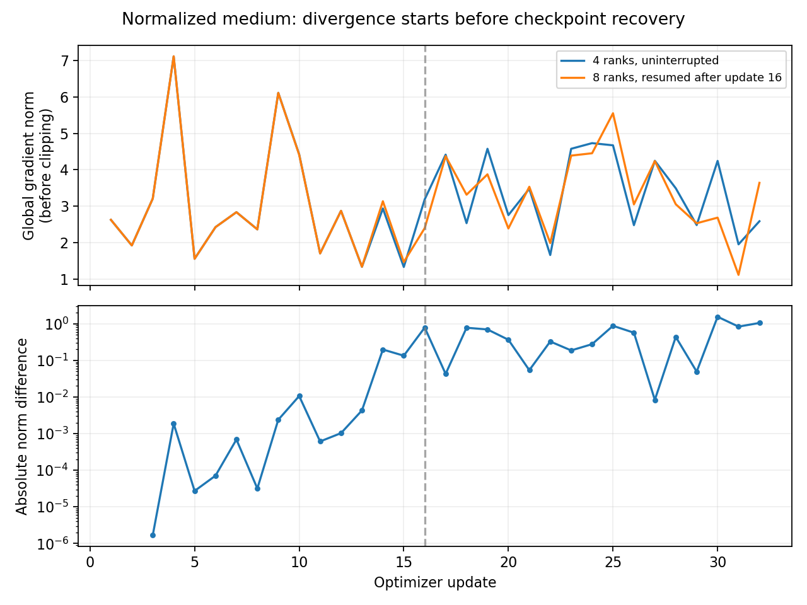

# Normalized medium Clariden check, 2026-10-13

The one-node exact checkpoint-resume gate passed. Two-node training and recovery
completed with finite losses, gradients, model/optimizer state and validation
metrics, but the strict cross-topology agreement gate **failed**. This is not a
repeat of the original nonfinite tensor overflow. Larger distributed training
has not been launched; the agreement failure needs diagnosis first.

**Subsequent result, 2026-10-14:** the
[gradient-precision investigation](se3_gradient_precision_20261014.md) reproduced
the divergence using only float32 summation order, then eliminated it with
high-precision gradient sums. The new four-/eight-GPU checks matched model and
optimizer state and validation results bitwise after 32 updates. The failed
checks documented here remain preserved as the original evidence.

## Execution and provenance

The training release was `4313ca60cb0de03f5ca4baa84c7a7b6a74fb1988` on
`se3-clariden-lightning`, deployed into a fresh code directory. Its archive
SHA-256, verified locally and on Clariden, was
`c33ded3f2310ddc6f956b6cdd899294d2b28579d9ed31db04813a4c2959b3047`.
The existing pinned ARM image, prepared dependency environment and verified
4,096/512 frozen bundle were reused. The production encoder/decoder were never
loaded or trained, and no graph regeneration occurred.

The model was width 64, depth 4, four heads, head dimension 16, with explicit
parameter-free equivariant MLP input normalization. Both topologies used seed
42, float32/no TF32, global batch 16, per-GPU microbatch one, AdamW 5e-4 and
clipping at 1. Accumulation was four on four GPUs and two on eight GPUs.
The debug configs set a three-minute collective timeout, preserving the
canonical default timeout in other configs. Every evaluation covered all 512
holdouts; nullable torsion metrics covered 511 structures.

| Job | Resources and ceiling | Outcome | Actual runtime |
| --- | --- | --- | --- |
| `3657046` | One node, four GPUs, debug, 30 minutes | Completed; exact resume gate passed | 290 seconds |
| `3657077` | Two nodes, eight GPUs, debug, 15 minutes | Training steps completed; final comparison failed | 164 seconds |

The one-node job saved after 16 updates, restored optimizer/RNG/sampler state,
continued to update 32, then ran an uninterrupted 32-update control in a separate
directory. Model parameters, buffers, optimizer state and validation metrics
matched exactly, with maximum parameter/buffer difference **0**.

After that gate passed, the two-node job saved at update 16 and resumed to 32.
Both training steps exited successfully. Its CPU postcheck inside the ARM
container rejected differences from the one-node control at `atol=rtol=1e-4`.
The batch job therefore exited 1. NCCL logs confirm **AWS Libfabric** transport;
there was no collective timeout or numerical forward/backward exception.

Maximum additional allocation was 4 GPUh. Actual Slurm node runtimes consumed
approximately **0.687 GPUh**. Conservative reservations remain **48 / 256 GPUh**
for the overall rollout, including previous jobs' full reserved ceilings.
No automatic retries, larger models or longer jobs were submitted.

## Agreement failure investigation

CPU inspection of the preserved update-16 and update-32 checkpoints found:

- Matching code, architecture, optimizer configuration and frozen-input/split
  provenance across topologies.
- Finite model and optimizer states and complete, unique validation IDs.
- Bitwise identical BatchNorm running means and variances at both checkpoints.
- Maximum parameter difference **0.0011602 at update 16**, before recovery,
  growing to **0.0112965 at update 32**. Recovery is therefore not where the
  divergence begins.
- Exactly matching logged global gradient norms at updates 1 and 2. Update 3
  differed by `1.67e-6`, update 4 by `0.00188`, and update 16 by `0.788`.



The first rejected field was `model.gotennet.node_init.atom_embed.weight`, with
maximum difference `0.0068258`. The larger maximum above comes from examining
the entire state dictionary rather than stopping at the first rejected field.
The strict gate was retained. A CPU replay reproduced its rejection, and a
failed-gate JSON was persisted in durable cluster artifacts. The verifier now
records failing parameter names and writes a failed-gate result before raising.

Float32 accumulation/reduction order followed by sensitive optimization is
consistent with these observations, but it has **not been established as the
cause**. A data/gradient synchronization issue has not been ruled out solely by
matching aggregate norms and BatchNorm statistics. The next diagnostic should
compare per-structure and reduced gradients at the first differing update,
starting from identical weights, before changing precision, loss, tolerances or
distributed scale.

## Validation and resources

These are short execution checks over 512 training presentations, not completed
learning or capacity trials. The one- and two-node validation values were:

| Metric | Four GPUs | Eight GPUs |
| --- | ---: | ---: |
| Geometry objective | 4.619008 | 4.603189 |
| FAPE | 0.939517 | 0.939069 |
| Aligned CA RMSD, Å | 16.50047 | 16.46208 |
| TM-score | 0.201980 | 0.201814 |
| lDDT | 0.203311 | 0.202637 |
| CA bond MAE, Å | 1.73854 | 1.73201 |
| Angle MAE, radians | 1.05873 | 1.05488 |

The modest metric differences do not establish cross-topology equivalence or
justify relaxing the failed parameter gate. The same structure-level holdout
limitations as the local experiments apply.

Median observed update throughput was approximately 13.6 versus 26.0 global
structures/second. These short runs are indicative measurements, not the
20-warmup/100-timed-update scaling benchmark. Rank-zero peak allocated GPU
memory was approximately 3.68 versus 3.43 GiB; other ranks were not separately
profiled for an all-rank maximum.

## Artifacts and commands

Durable root: `/capstor/store/cscs/swissai/a0117/foldtree2/se3`.
Runs: `runs/normalized_debug_one`, `runs/normalized_debug_control`,
`runs/normalized_debug_two`. Each candidate retains `update-016.ckpt` and
`last.ckpt`, events, software/provenance and paired validation files.
Logs are in the pinned code directory under `logs/normalized_debug_*-JOBID.out`.
Gate/submission records are under `artifacts`.

Committed evidence is in
[normalized_cluster](se3_clariden_evidence/normalized_cluster/): original logs,
events, provenance, per-structure validation, gates, checkpoint divergence,
gradient comparisons and accounting summary. Downloaded checkpoints are retained
locally under `runs/se3_clariden/normalized_cluster_checkpoints`; tensors are not
committed. Preflight tests passed 14 tests with the existing strict expected
failure for the blocked six-layer model.

The submit helper is intentionally one phase at a time and refuses duplicate
budget reservations. Do not rerun these commands as retries without reconciling
the recorded jobs and preserving their evidence:

```bash
cd /capstor/store/cscs/swissai/a0117/foldtree2/se3/code/4313ca60cb0de03f5ca4baa84c7a7b6a74fb1988
python3 -m scripts.submit_se3_normalized_checks normalized_debug_one --submit
# Only after the first gate has passed and its job completed:
python3 -m scripts.submit_se3_normalized_checks normalized_debug_two --submit
```

The original failed postcheck did not emit JSON. Its persisted failed-gate file
comes from CPU replay against the resumed one-node checkpoint, independently
proven bitwise identical to the uninterrupted control. The replay's local
reference paths are retained to distinguish that evidence from the original job.
