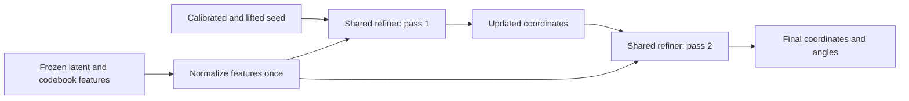

# Shared two-pass SE(3) refiner: architecture branch

Branch **`se3-recycled-refiner`**, based on `c5079e1` of
`se3-clariden-lightning`. The user authorized isolated architecture development,
with merging conditional on demonstrated improvement. The queued loss trials
remain pinned to `d7108d96e95e2fa7cf1ce07abdda5fc61abbfb48`; no files in that
checkout or its configurations were changed. **No merge has been performed and no architecture job has
been submitted.**

## Implemented change

`RecycledSE3Denoiser` shares the complete existing refiner across two coordinate
passes. It inherits the same parameter/state names: both width-64/depth-four
variants have **1,684,514 parameters**, with no added learned gates or heads.
The existing single-pass model remains the default.



The initial calibration/normal lift occurs once upstream. Frozen scalar
features are normalized/dropout-applied once per outer call, preserving one
BatchNorm update and the trainer's global-statistics replay. Each pass rebuilds
geometry-derived contacts from its current predicted coordinates, while retaining
frozen contact inputs. Coordinates and the shared feature normalization remain
attached to autograd through both passes. Radius normalization is applied to
current coordinates by the existing refiner, with physical units/translation
restored after each pass. Existing scalar/angle heads, residual gain 32,
normalization safeguards and float32 model computation are retained.

`forward(..., return_steps=True)` exposes intermediate coordinate/angle pairs;
the default API returns the final pair. Recycling is explicitly residue-only,
limited to one/two passes, and rejects missing/nonfinite predicted coordinates.
Masked nodes, short/coincident chains and independent mixed-chain translations
are covered. No ground-truth coordinates enter the forward graph.

## Matched experiment configurations

Three configurations are prepared, without submitting them:

| Configuration | Passes | Training loss weights by pass |
|---|---:|---|
| `recycling_v1_single.yaml` | 1 | `[1]` |
| `recycling_v1_two_final.yaml` | 2 | `[0, 1]` |
| `recycling_v1_two_aux.yaml` | 2 | `[0.3, 0.7]` |

The primary comparison is single versus two-final, with exactly the same final
loss, training IDs/order, seed, initialization, optimizer reset, global batch,
width/depth and four-epoch/2,048-update budget. The auxiliary-loss variant is a
separate experiment so intermediate supervision is not confused with recycling.
Validation losses/structural metrics always use the final prediction, and all
three select checkpoints using final evaluation FAPE. Training events record
per-pass losses/weights from the last microbatch. Two passes cost additional
compute/activation memory; report GPUh, throughput and peak memory alongside
step-matched quality, and consider a measured compute-matched control before
claiming efficiency or capacity improvements.

The prepared configurations currently retain the original soft-FAPE/bond loss.
Wait for the separately queued loss trial results before selecting a common
objective and parent checkpoint for architecture training. If adopting a loss
candidate, carry its exact loss configuration into **every** architecture arm;
never change architecture and objective together within the primary comparison.

Example arguments for an allocated Clariden run using a pinned archive of this
branch and the existing frozen cache (not a submission command):

```bash
python -m foldtree2.train_se3_lightning \
  --config configs/clariden_se3/recycling_v1_two_final.yaml \
  --warm-start /capstor/store/cscs/swissai/a0117/foldtree2/se3/runs/growth_fp64_8192/best.ckpt \
  --allow-refinement-change
```

The explicit flag performs a **weights-only initialization**, restarting the
optimizer and sample stream for all arms. It verifies identical loss, LR,
model shape, normalization, frozen data/split identity and preprocessing.
Known pre-architecture source manifests are pinned in
`foldtree2/src/recycling_parent_sources.json`; only the reviewed trainer,
forward API and feature-normalization refactor cross this source boundary.
Other model/loss/preprocessing source changes are rejected. The parent can be
the original growth checkpoint or a completed loss trial from the pinned loss
implementation, with a matching configuration. Simultaneous
`--allow-loss-change` and `--allow-refinement-change` is rejected. Standard
resume remains strict about source/configuration/topology and does not silently
switch the number of passes.

## Verification

**88 passed, one skipped, one expected failure** across recycling, balanced and
legacy losses, Lightning, refiner correctness and geometry validation. The
GPU-only check was skipped in the restricted sandbox; depth-six instability is
the existing expected failure. Tests establish:

* Identical parameter draws/state keys/counts, and exact first-pass agreement.
* One feature normalization per outer forward, finite optimizer-step gradients,
  and nonzero gradients reaching first-pass coordinates from the final loss.
* SO(3)/translation equivariance at float32 atol/rtol 1e-4, invariant angles,
  masked NaN padding, short/coincident chains and mixed chain lengths.
* Geometry contacts change when the first pass changes the geometry.
* Explicit auxiliary weights, final-only evaluation FAPE, source/data/loss
  migration guards and rejection of incompatible resume provenance.

The [real-cache CPU audit](se3_clariden_evidence/recycling_v1/audit.json) used eight
retained **training** structures, the original epoch-16 trained checkpoint and
no production-model calls or optimizer steps. All first-pass predictions matched
the single-pass reference exactly. Backward through two passes was finite:
first-pass coordinate-gradient norm **0.159012**, model-gradient norm **8.207451**.

Simply applying the one-pass-trained weights twice **worsened** these eight
training examples; this is an inference/stability audit, not trained two-pass
performance or a held-out comparison:

| Metric | Trained single pass | Same weights applied twice |
|---|---:|---:|
| fape | 0.939702 | 0.942112 |
| ca_rmsd | 14.651221 | 15.299386 |
| tm_score | 0.234069 | 0.202763 |
| lddt | 0.247791 | 0.242750 |
| ca_bond_mae | 0.940911 | 1.445101 |

Recorded aggregate CPU forward times were 12.88 s and 17.38 s for these eight
structures, including first-call warmup; they are not warmed benchmarks or GPU
resource estimates. This audit provides **no evidence of improved accuracy**.
The two-pass architecture must be trained end to end before judging it.

## Merge gate

Keep this branch separate until all of the following pass:

1. CUDA finite-gradient and save/resume checks, followed by a two-node check,
   using the same model/loss/precision that will be trained.
2. A trained, matched comparison improves held-out FAPE against the single-pass
   control, with paired per-structure comparisons and uncertainty reported.
3. No material structural regression: >5% increase in error or >0.01 absolute
   decrease in TM-score/lDDT fails the existing screening bounds. Inspect bond,
   bend/torsion and angle metrics as well as global accuracy.
4. Measure throughput, GPU memory, failure counts and actual GPUh; preserve
   checkpoint hashes, source revisions, splits and selected-epoch provenance.

The existing 512 holdouts are repeatedly monitored development data. Reserve
fresh structure-level holdouts for confirmation before promotion; independence
from frozen production-model pretraining is not claimed. Failed/neutral
experiments remain recorded on this branch. No merge or training expansion occurs automatically; merge only after the
criteria above satisfy the user's improvement condition.
