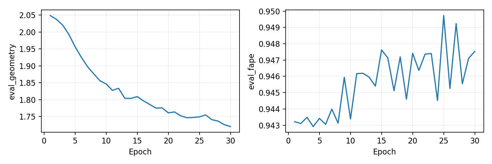

# Bounded 3D-seed learning test, 2026-10-09

Completed 32 structures × 30 epochs (120 optimizer updates), then 128 disjoint evaluation structures. Device: `cuda:0`. GPU 1 remained occupied by an unrelated workload.

The candidate was predeclared as lifted circular: fraction-0.1 oriented normal lift, full-range sin/cos angles, zero-initialized residual, RMS normalization and residual gain 32. Eight-structure control screens did not select the full-run candidate. Checkpoint selection used training geometry only.

Width 32, depth 2, two heads, head dimension 16; float32, seed 42 reset per case, batch 1/effective 8, AdamW 5e-4, weight decay 0.01, clipping 1, geometry-driven scheduler. Calibration used only the 32 training chains. Frozen epoch-40 production caches were reused without model calls or graph regeneration.

Training geometry: **2.052543 → 1.720513**, a **16.18%** reduction from the lifted model's own initialized baseline. Selected epoch 30.

| Metric | Lifted input | Refined | Mean paired delta | Improved / 128 |
|---|---:|---:|---:|---:|
| fape | 0.947859 | 0.958257 | +0.010397 | 4 |
| ca_rmsd | 18.403283 | 19.603408 | +1.200125 | 39 |
| tm_score | 0.192221 | 0.194858 | +0.002637 | 69 |
| lddt | 0.195812 | 0.193044 | -0.002768 | 66 |
| ca_bond_mae | 1.762846 | 3.806308 | +2.043463 | 3 |
| ca_bend_mae_radians | 0.843561 | 0.824324 | -0.019237 | 81 |
| ca_torsion_mae_radians | 1.566216 | 1.551565 | -0.014651 | 72 |

Comparisons use identical structures and masks. lDDT is CA-only with explicit diagonal exclusion; TM-score uses TM-align. These are refiner holdouts, with no claim of independence from production pretraining. Per-structure raw, calibrated, lifted-input and refined measurements are retained; calibration and seed-lift gains do not count as learning.

Gates: ≥20% training geometry reduction **False**; improved held-out FAPE **False**; no material structural regression **False**. Material regression means >5% increase in error or >0.01 decrease in TM-score/lDDT. These are pre-existing screening thresholds, without statistical uncertainty claims.

Ready for a larger run: **False**. A revised 512/128 pilot is still required before larger-data training, even if this bounded test passes.

Full-training mean epoch time 5.27 s; peak allocated GPU memory 1.590 GiB. Failure events: 0. Gradients and losses were explicitly checked for finiteness at every training step.

See the retained evidence for source snapshots, checkpoint hashes, software versions, split IDs, configuration, controls, paired metrics and correctness logs. Production weights, the staged transformer and historical reports were unchanged.

Refined angle-head mean circular MAE: 0.581989 radians. The frozen input has no angle-head prediction, so its head MAE is undefined; CA-derived bend/torsion errors are compared above.

## FAPE and loss-path audit

Frame projection agrees exactly with an explicit row-vector reference on all 32 structures. Tests additionally cover the shared coarse-backbone FAPE reference, independent rigid transforms and double-precision finite-difference gradcheck. Coordinates are evaluated in restored physical units; FAPE clamps at 10 Å and divides by 10. There is no detach between predicted coordinates and this loss.

A masking bug was reproduced: masked NaN predictions could yield finite FAPE but nonfinite valid gradients. Predicted coordinates are now masked before constructing frames, and nonfinite valid coordinates are rejected. The correction passed regression tests. It was applied after this run; executed source snapshots preserve the original implementation. This run had finite masked model outputs and finite gradients, so that bug does not explain its regression.

Mean clamped frame–point fraction: 86.58% initially, 86.96% trained. Unclamped mean error: 30.197 → 29.828 Å. FAPE itself increases 0.943514 → 0.947533, while normalized all-pairs distance loss drops 1.109009 → 0.772993.

Mean coordinate-gradient norms (FAPE / distance): 0.043982 / 0.008165 initially and 0.006037 / 0.006029 trained. Mean gradient cosine is 0.011 initially and 0.069 trained. Saturation does not mean the entire FAPE gradient vanishes; the remaining signal is concentrated in unsaturated pairs and sensitive local frames.

The actual objective is all-pairs SmoothL1 distance / 10 + clamped CA-frame FAPE + 0.1 circular angle loss. It has no separately weighted backbone bond constraint. The angle head is an auxiliary scalar prediction; it does not reconstruct the coordinate output. Improved composite geometry loss therefore does not guarantee improved FAPE or chemically plausible backbone bonds.

Next diagnostic: a separately versioned objective ablation with an explicit local bond term and a less saturated FAPE training term, retaining the existing clamped FAPE evaluation metric and identical splits. Verify gradients and relative weighting before another bounded learning test. No loss-weight change or larger training was silently applied here.
